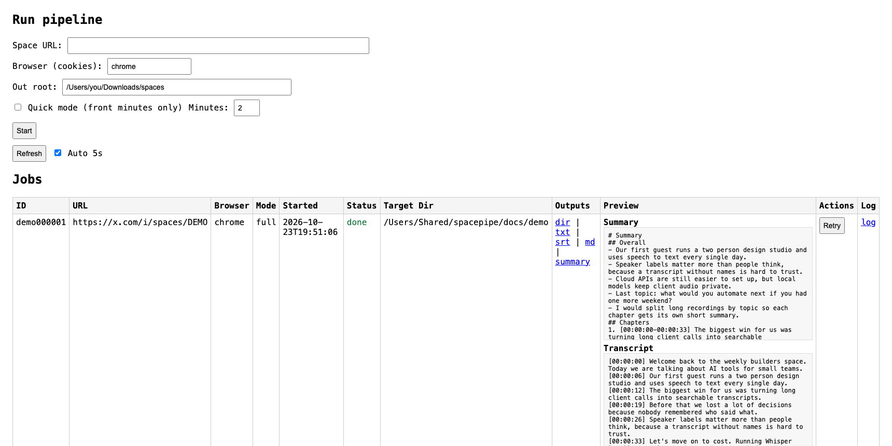
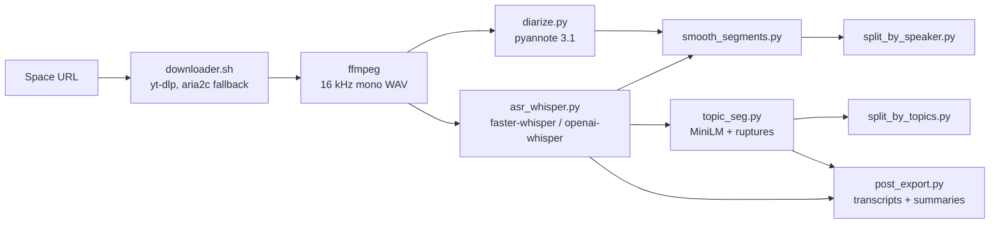

# Spacepipe

**Turn a long X (Twitter) Space into speaker-labelled transcripts, topic chapters and short summaries, running locally on your own machine.**

把一场几个小时的 X Space 语音直播自动整理成：带说话人标记的文字稿、按话题切分的章节，以及每一章的简短摘要。全部在本地运行，音频不上传到任何云服务。



## Why

Long audio is hard to search and harder to quote. A two-hour Space usually has several speakers and drifts across many topics. Spacepipe answers three questions automatically:

- **What was said?** Whisper speech-to-text with timestamps (`.txt`, `.srt`, `.md`).
- **Who said it?** Speaker diarization with `pyannote.audio`, cleaned up by a smoothing pass.
- **Where are the topics?** Sentence embeddings plus change-point detection split the talk into chapters, each with an extractive summary.

## How it works



| Step | Script | What it does |
|---|---|---|
| Download | `downloader.sh` | Downloads the Space audio with `yt-dlp` using your browser's cookies. If that fails, it falls back to fetching the HLS stream and merging chunks with `aria2c` and `ffmpeg`. Can stop after the first N minutes. |
| Diarize | `diarize.py`, `quick_diarize.py` | Runs `pyannote/speaker-diarization-3.1` and writes RTTM and CSV. Works with both pyannote 3.x and 4.x output types, and with torch 2.6+ `weights_only` checkpoint loading. |
| Transcribe | `asr_whisper.py` | `faster-whisper` (small model, VAD on) on CUDA or CPU, or falls back to `openai-whisper` (which can use Apple's MPS). |
| Smooth | `smooth_segments.py` | Fixes typical diarization noise: merges same-speaker gaps under 0.6 s, absorbs short interjections ("嗯", "yeah", "right") into the surrounding speaker, and enforces a 2.5 s minimum segment. |
| Chapters | `topic_seg.py` | Embeds each sentence with `all-MiniLM-L6-v2` and finds topic boundaries with kernel change-point detection (`ruptures`). Merges chapters shorter than 25 s. |
| Export | `split_by_speaker.py`, `split_by_topics.py`, `post_export.py` | Writes per-speaker and per-chapter audio clips, transcripts, and frequency-based extractive summaries (Chinese is segmented with `jieba` when installed). |

## Quick start

### 1. Install

System tools (macOS with Homebrew):

```bash
brew install yt-dlp aria2 ffmpeg wget
```

Python 3.10+ in a virtual environment:

```bash
cd spacepipe-github
uv venv && source .venv/bin/activate      # or: python3 -m venv .venv
uv pip install -r requirements.txt        # or: pip install -r requirements.txt
```

Speaker diarization uses a gated model. Accept its terms on the [pyannote/speaker-diarization-3.1](https://huggingface.co/pyannote/speaker-diarization-3.1) page, then either run `huggingface-cli login` or `export HF_TOKEN=...`.

### 2. Try the UI without any credentials

```bash
python3 webapp.py --demo --port 8000
```

Open http://127.0.0.1:8000. A finished sample job built from `docs/demo/` shows what the outputs look like.

### 3. Process a real Space

From the web UI: paste the Space URL, choose the browser to read cookies from, and click **Start**. Tick **Quick mode** to process only the first few minutes as a fast check.

Or from the command line:

```bash
# full run
bash run_space_pipeline.sh "https://x.com/i/spaces/XXXX" chrome ~/Downloads/spaces

# quick check: only the first 3 minutes
bash run_space_pipeline.sh "https://x.com/i/spaces/XXXX" chrome ~/Downloads/spaces 1 3
```

Arguments: `<space_url> [browser] [out_root] [quick_mode 0|1] [quick_minutes]`.

To download the audio only, without transcription:

```bash
./downloader.sh "https://x.com/i/spaces/XXXX" chrome ~/Downloads/spaces       # whole Space
./downloader.sh "https://x.com/i/spaces/XXXX" chrome ~/Downloads/spaces 3     # first 3 minutes
```

Tip: add a shell shortcut to `~/.zshrc` so you can run `xspace <url>` from anywhere:

```bash
_xspace() { (cd ~/path/to/spacepipe-github && ./downloader.sh "$1" chrome "$HOME/Downloads/spaces" "${2:-}"); }
alias xspace='noglob _xspace'   # noglob: paste URLs containing "?" without quotes
```

## Outputs

Each Space gets its own folder named `<date> - <title>`:

```
20260104 - Example Space/
├── 20260104 - Example Space.m4a     original audio
├── asr.json                         timestamped ASR segments
├── chapters.json                    topic boundaries with a representative sentence
├── diarization/
│   ├── segments.rttm / segments.csv
│   └── segments_smoothed.csv
├── speakers/SPEAKER_00/…wav         one clip per speaker turn
├── topics/00_0-412.wav …            one clip per chapter
├── transcripts/transcript.txt|.srt|.md
└── summaries/summary.md|.json
```

See [`docs/demo/`](docs/demo/) for a small complete example.

## Web UI

`webapp.py` is a single-file WSGI app with no dependencies beyond the Python standard library. It runs each job in a background thread, streams logs to `web_logs/`, and lets you cancel, retry, open outputs and preview the summary and transcript in the page.

## Limitations

- Downloading depends on `yt-dlp` support for X Spaces and on being logged in to X in the chosen browser.
- Summaries are extractive (they pick existing sentences) rather than generated by an LLM.
- The number of chapters is fixed at about 8 per run (`n_bkpt` in `topic_seg.py`).
- Only download and process Spaces you have the right to use.

## License

MIT, see [`LICENSE`](LICENSE).
